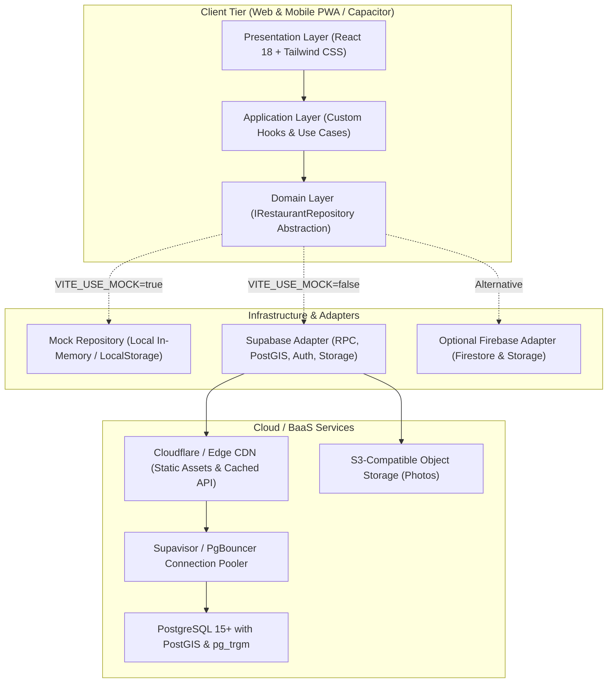

# RestôLog - Architecture & Technical Justification

## 1. Executive Summary & Philosophy

RestôLog is designed around two core principles:
1. **Lightweight & Agile MVP:** Minimal footprint, instantaneous boot, zero runtime bloat, and fully functional out-of-the-box (including offline/mock mode).
2. **High-Scale Evolution:** Built on Clean Architecture and SOLID principles, enabling seamless scaling to thousands of requests per minute (RPM) using minimal server resources via PostgreSQL spatial indexing, connection pooling, and CDN caching.

---

## 2. System Architecture Diagram



---

## 3. Technology Stack & Justification

| Layer | Technology | Justification & Trade-offs |
| :--- | :--- | :--- |
| **Frontend Framework** | **React 18 + Vite + TypeScript** | Instant build/HMR, minimal bundle size (< 130KB gzipped), zero framework bloat (vs Next.js SSR server overhead). Mobile-ready for PWA or Capacitor wrapping. |
| **Styling** | **Tailwind CSS** | Atomic CSS engine producing only used classes (24KB total CSS), WCAG AA compliant contrast, no heavy UI library dependencies. |
| **Primary BaaS / DB** | **Supabase (PostgreSQL + PostGIS)** | Built-in spatial queries (`ST_DWithin`, `ST_Distance`), native trigram fuzzy matching (`pg_trgm`) for duplicate detection, and automated rating triggers. |
| **Alternative BaaS** | **Firebase (Firestore + Storage)** | Document-based, easy setup, but lacks native geospatial indexing (requires complex geohash workarounds or external Algolia/Typesense) and is more costly at high query volume. |
| **Icons & Utilities** | **Lucide React + clsx** | Lightweight, tree-shakeable icons and class merging. |

---

## 4. Deep-Dive: Supabase vs. Firebase for RestôLog

The user requested an evaluation between **Supabase** and **Firebase**:

### Why Supabase (PostgreSQL) is the Recommended Choice:
1. **Geospatial Queries (Location Proximity):**
   - *Requirement:* Find restaurants close to the user's GPS coordinates.
   - *Supabase:* PostgreSQL has **PostGIS**, the industry-standard spatial engine. A single query with `ST_DWithin(location, ..., max_dist)` using a spatial GIST index executes in < 2ms, returning ordered distances directly.
   - *Firebase Firestore:* Firestore cannot execute native multi-dimensional proximity queries. It requires splitting coordinates into Geohashes, running bounding-box queries, and performing client-side post-filtering. This dramatically increases read costs and complexity.
2. **Duplicate Prevention (Anti-Duplication):**
   - *Requirement:* Prevent duplicate restaurant entries (e.g. typos, slight name variations, close coordinates).
   - *Supabase:* Uses PostgreSQL `pg_trgm` extension for trigram fuzzy matching (`similarity(name, '...') > 0.35`) combined with coordinate proximity (< 200m).
   - *Firebase:* Requires full-text third-party search integrations (Algolia / Typesense) which incurs additional monthly costs.
3. **Menu & Pricing Data Integrity:**
   - Restaurant menus have relational structures: Day of week, categories (Buffet livre vs Por Quilo vs Prato Feito), and reviews. Relational schemas ensure consistency and automatic cascading deletes.
4. **Rating Aggregation:**
   - In Supabase, a PostgreSQL trigger automatically computes the average rating and review count on write. In Firebase, this requires a Cloud Function or client-side transactions.

### Firebase Compatibility:
If Firebase is selected later, the code is 100% prepared: the business domain communicates solely through the `IRestaurantRepository` interface (Dependency Inversion Principle). Swapping from Supabase to Firebase requires only writing a `FirebaseRestaurantRepository` without changing a single UI component.

---

## 5. Clean Architecture & SOLID Implementation

```
src/
├── domain/                      # Enterprise / Core Domain (Zero framework dependencies)
│   ├── entities/                # Restaurant, MenuItem, Review, Suggestion
│   └── repositories/            # IRestaurantRepository (Port / Interface)
├── infrastructure/              # Adapters & Implementations
│   ├── config.ts                # Inversion of Control / DI Factory
│   ├── mock/                    # In-memory Mock Repository (Zero config)
│   └── supabase/                # Supabase PostGIS Repository
├── application/                 # Use Cases & Application State
│   ├── useRestaurants.ts        # Querying, filtering, sorting
│   ├── useFavorites.ts          # Local/Cloud favorites synchronization
│   └── useGeolocation.ts        # Browser GPS & Haversine distance
└── presentation/                # React UI Components & Pages
    ├── components/              # Header, Card, Modals, FilterBar, Rating
    └── App.tsx                  # Main Composition Root
```

### SOLID Principles in Action:
- **Single Responsibility (SRP):** Each component and service has one responsibility. For example, `useGeolocation` handles only GPS permissions and coordinates; `StarRating` renders and handles ratings.
- **Open/Closed Principle (OCP):** New pricing models or storage backends can be added by implementing new classes without modifying existing domain entities.
- **Liskov Substitution Principle (LSP):** Both `MockRestaurantRepository` and `SupabaseRestaurantRepository` can be substituted interchangeably without breaking the application.
- **Interface Segregation Principle (ISP):** Small, focused interfaces (`RestaurantFilterParams`, `IRestaurantRepository`).
- **Dependency Inversion Principle (DIP):** The UI and custom hooks depend on `IRestaurantRepository`, not on concrete database drivers.

---

## 6. Scalability Blueprint: Supporting Thousands of Req/Min

To evolve from a lightweight MVP (< 100 closed users) to high-scale production (> 10,000 req/min) with minimal resource usage:

1. **Spatial & Trigram Indexing:**
   - Spatial queries use `GIST (location)` index.
   - Text searches use `GIN (name gin_trgm_ops)` index.
   - Database queries remain O(log N) instead of table scans.
2. **Connection Pooling via Supavisor / PgBouncer:**
   - Enables thousands of concurrent clients to share a pool of 20-50 direct PostgreSQL connections.
3. **Edge Caching & Read Replicas:**
   - Because restaurant catalog data changes infrequently compared to reads, an Edge CDN (Cloudflare or Vercel Edge Cache) with `stale-while-revalidate` (SWR) caches restaurant lists for 60 seconds.
   - Database reads drop by 95%+, allowing a modest server to handle massive traffic.
4. **Client-Side Optimistic Updates:**
   - Favorites and reviews update the local state immediately, ensuring zero perceived latency for users.

